# Домашнее задание к занятию 6 «Создание собственных модулей»

## Подготовка к выполнению

1. Создайте пустой публичный репозиторий в своём любом проекте: `my_own_collection`.

**Выполнено**

Репозиторий: https://github.com/deravchukma/my_own_collection

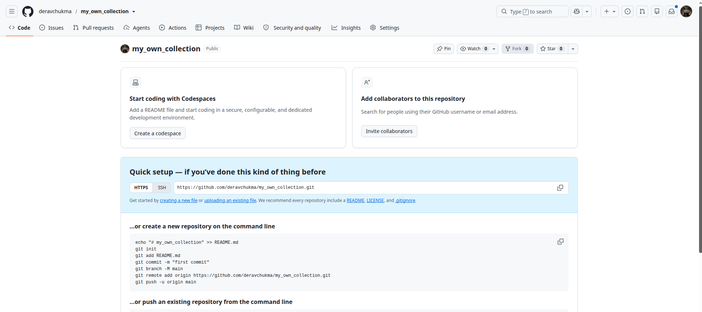

2. Скачайте репозиторий Ansible: `git clone https://github.com/ansible/ansible.git` по любому, удобному вам пути.

**Выполнено**

Клонирована ветка `stable-2.21` (`git clone --depth 1 -b stable-2.21 ...`): ветки `devel` и `stable-2.22` требуют Python >= 3.13, на ВМ Python 3.12.3.

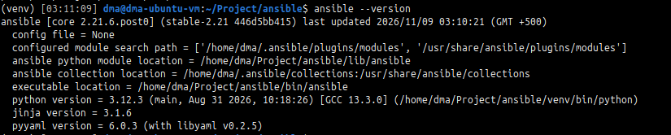

3. Зайдите в директорию Ansible: `cd ansible`.

**Выполнено**

4. Создайте виртуальное окружение: `python3 -m venv venv`.

**Выполнено**

Предварительно установлен пакет `python3.12-venv`, без него `python3 -m venv` падает с ошибкой «ensurepip is not available».

5. Активируйте виртуальное окружение: `. venv/bin/activate`. Дальнейшие действия производятся только в виртуальном окружении.

**Выполнено**

6. Установите зависимости `pip install -r requirements.txt`.

**Выполнено**

7. Запустите настройку окружения `. hacking/env-setup`.

**Выполнено**

8. Если все шаги прошли успешно — выйдите из виртуального окружения `deactivate`.

**Выполнено**

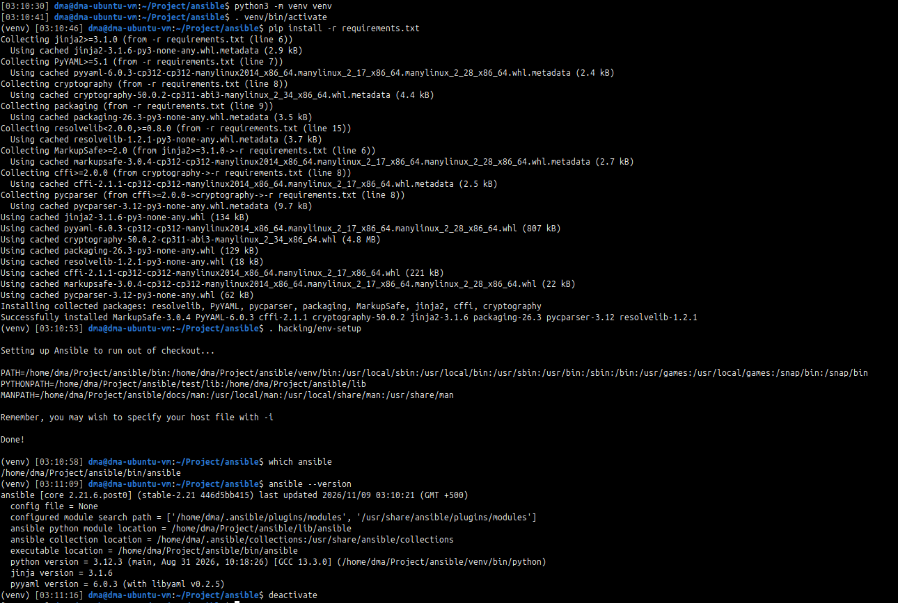

9. Ваше окружение настроено. Чтобы запустить его, нужно находиться в директории `ansible` и выполнить конструкцию `. venv/bin/activate && . hacking/env-setup`.

## Основная часть

Ваша цель — написать собственный module, который вы можете использовать в своей role через playbook. Всё это должно быть собрано в виде collection и отправлено в ваш репозиторий.

**Шаг 1.** В виртуальном окружении создайте новый `my_own_module.py` файл.

**Выполнено**


**Шаг 2.** Наполните его содержимым:

```python
#!/usr/bin/python

# Copyright: (c) 2018, Terry Jones <terry.jones@example.org>
# GNU General Public License v3.0+ (see COPYING or https://www.gnu.org/licenses/gpl-3.0.txt)
from __future__ import (absolute_import, division, print_function)
__metaclass__ = type

DOCUMENTATION = r'''
---
module: my_test

short_description: This is my test module

# If this is part of a collection, you need to use semantic versioning,
# i.e. the version is of the form "2.5.0" and not "2.4".
version_added: "1.0.0"

description: This is my longer description explaining my test module.

options:
    name:
        description: This is the message to send to the test module.
        required: true
        type: str
    new:
        description:
            - Control to demo if the result of this module is changed or not.
            - Parameter description can be a list as well.
        required: false
        type: bool
# Specify this value according to your collection
# in format of namespace.collection.doc_fragment_name
extends_documentation_fragment:
    - my_namespace.my_collection.my_doc_fragment_name

author:
    - Your Name (@yourGitHubHandle)
'''

EXAMPLES = r'''
# Pass in a message
- name: Test with a message
  my_namespace.my_collection.my_test:
    name: hello world

# pass in a message and have changed true
- name: Test with a message and changed output
  my_namespace.my_collection.my_test:
    name: hello world
    new: true

# fail the module
- name: Test failure of the module
  my_namespace.my_collection.my_test:
    name: fail me
'''

RETURN = r'''
# These are examples of possible return values, and in general should use other names for return values.
original_message:
    description: The original name param that was passed in.
    type: str
    returned: always
    sample: 'hello world'
message:
    description: The output message that the test module generates.
    type: str
    returned: always
    sample: 'goodbye'
'''

from ansible.module_utils.basic import AnsibleModule


def run_module():
    # define available arguments/parameters a user can pass to the module
    module_args = dict(
        name=dict(type='str', required=True),
        new=dict(type='bool', required=False, default=False)
    )

    # seed the result dict in the object
    # we primarily care about changed and state
    # changed is if this module effectively modified the target
    # state will include any data that you want your module to pass back
    # for consumption, for example, in a subsequent task
    result = dict(
        changed=False,
        original_message='',
        message=''
    )

    # the AnsibleModule object will be our abstraction working with Ansible
    # this includes instantiation, a couple of common attr would be the
    # args/params passed to the execution, as well as if the module
    # supports check mode
    module = AnsibleModule(
        argument_spec=module_args,
        supports_check_mode=True
    )

    # if the user is working with this module in only check mode we do not
    # want to make any changes to the environment, just return the current
    # state with no modifications
    if module.check_mode:
        module.exit_json(**result)

    # manipulate or modify the state as needed (this is going to be the
    # part where your module will do what it needs to do)
    result['original_message'] = module.params['name']
    result['message'] = 'goodbye'

    # use whatever logic you need to determine whether or not this module
    # made any modifications to your target
    if module.params['new']:
        result['changed'] = True

    # during the execution of the module, if there is an exception or a
    # conditional state that effectively causes a failure, run
    # AnsibleModule.fail_json() to pass in the message and the result
    if module.params['name'] == 'fail me':
        module.fail_json(msg='You requested this to fail', **result)

    # in the event of a successful module execution, you will want to
    # simple AnsibleModule.exit_json(), passing the key/value results
    module.exit_json(**result)


def main():
    run_module()


if __name__ == '__main__':
    main()
```
Или возьмите это наполнение [из статьи](https://docs.ansible.com/ansible/latest/dev_guide/developing_modules_general.html#creating-a-module).

**Выполнено**

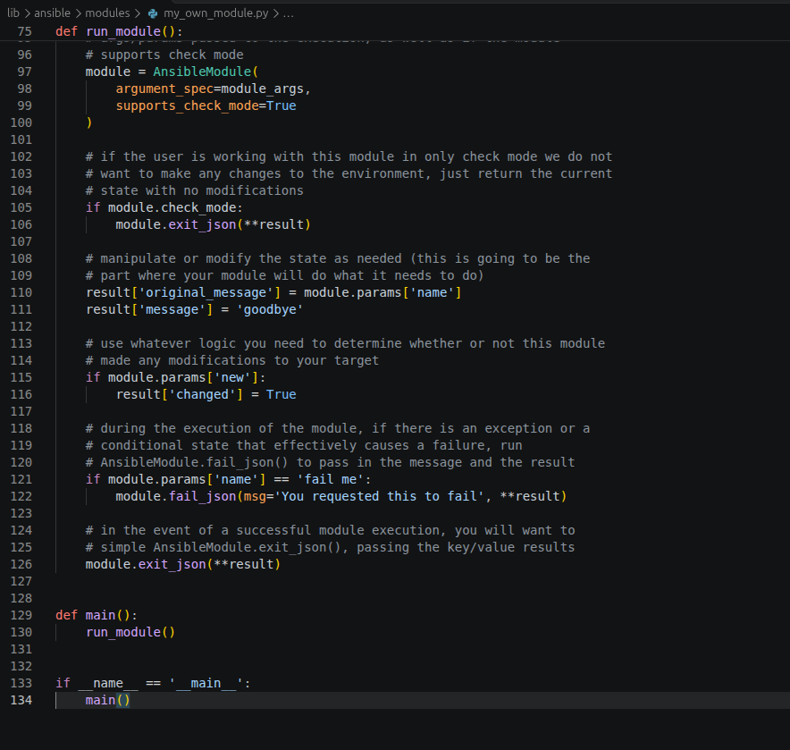


**Шаг 3.** Заполните файл в соответствии с требованиями Ansible так, чтобы он выполнял основную задачу: module должен создавать текстовый файл на удалённом хосте по пути, определённом в параметре `path`, с содержимым, определённым в параметре `content`.

**Выполнено**

Модуль: [plugins/modules/my_own_module.py](https://github.com/deravchukma/my_own_collection/blob/1.0.0/plugins/modules/my_own_module.py)

- параметры `path` (тип `path`, обязательный) и `content` (строка, по умолчанию `''`);
- идемпотентность: файл перезаписывается, только если его содержимое отличается от `content`;
- запись через временный файл и `module.atomic_move`;
- поддержка `check_mode` и `diff`;
- из шаблона удалён `extends_documentation_fragment` (ссылка на несуществующий фрагмент документации).

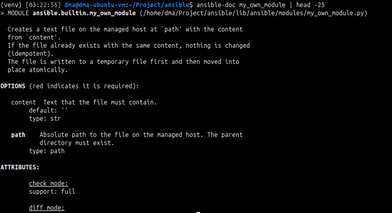


**Шаг 4.** Проверьте module на исполняемость локально.

**Выполнено**

Аргументы: [module-test/args.json](./module-test/args.json), запуск `python -m ansible.modules.my_own_module args.json`.

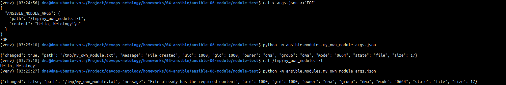


**Шаг 5.** Напишите single task playbook и используйте module в нём.

**Выполнено**

Playbook: [module-test/site.yml](./module-test/site.yml), инвентарь: [module-test/inventory.yml](./module-test/inventory.yml).

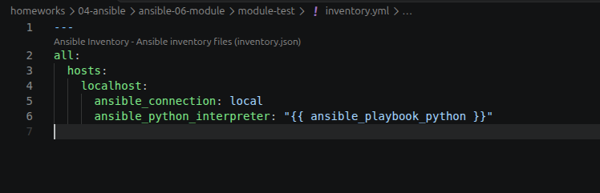

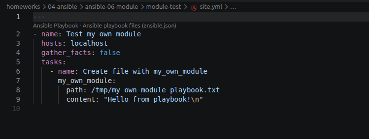


**Шаг 6.** Проверьте через playbook на идемпотентность.

**Выполнено**

Повторный запуск — `changed=0`. Дополнительно проверены режимы `--check --diff` и `--diff`.

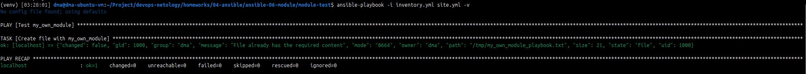

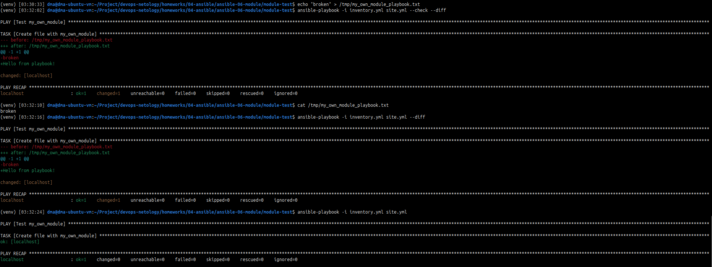


**Шаг 7.** Выйдите из виртуального окружения.

**Выполнено**

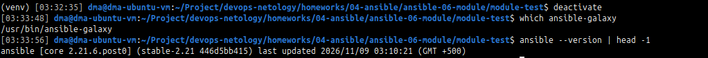


**Шаг 8.** Инициализируйте новую collection: `ansible-galaxy collection init my_own_namespace.yandex_cloud_elk`.

**Выполнено**

Каталог коллекции `my_own_namespace/yandex_cloud_elk` переименован в `my_own_collection`, чтобы корень коллекции (`galaxy.yml`) совпадал с корнем репозитория.

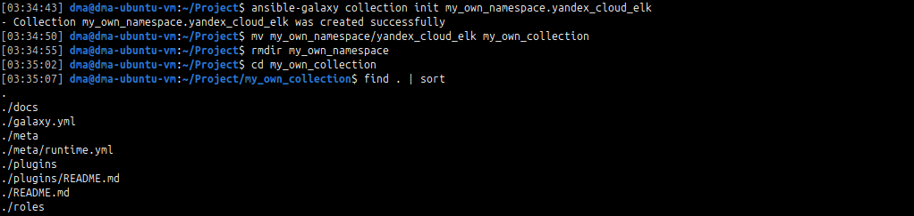


**Шаг 9.** В эту collection перенесите свой module в соответствующую директорию.

**Выполнено**

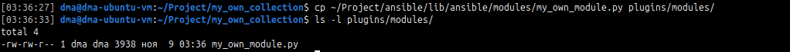


**Шаг 10.** Single task playbook преобразуйте в single task role и перенесите в collection. У role должны быть default всех параметров module.

**Выполнено**

Роль `my_own_role`: одна задача, переменные `my_own_role_path` и `my_own_role_content` в `defaults/main.yml`.

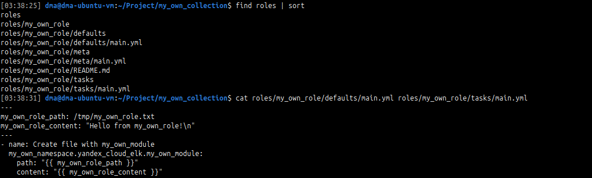


**Шаг 11.** Создайте playbook для использования этой role.

**Выполнено**

Playbook: `playbooks/site.yml`.

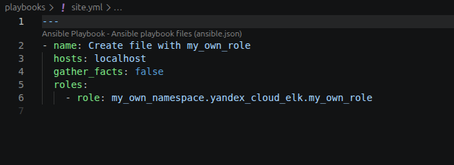


**Шаг 12.** Заполните всю документацию по collection, выложите в свой репозиторий, поставьте тег `1.0.0` на этот коммит.

**Выполнено**

Тег [1.0.0](https://github.com/deravchukma/my_own_collection/tree/1.0.0).

После проверки ansible-lint инвентарь перенесён из `playbooks/inventory.yml` (скриншот 12-1) в `playbooks/inventory/hosts.yml`: ansible-lint считает playbook-ом любой `*.yml` в каталоге `playbooks/`. Итог ansible-lint: `Passed`, профиль `production`.

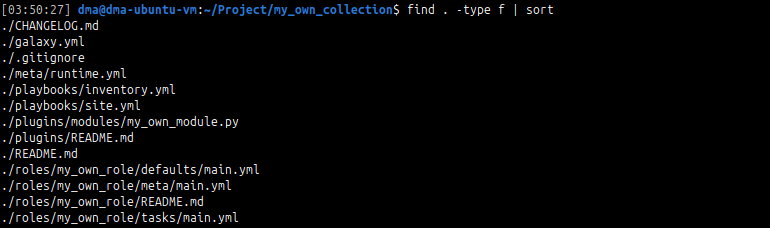

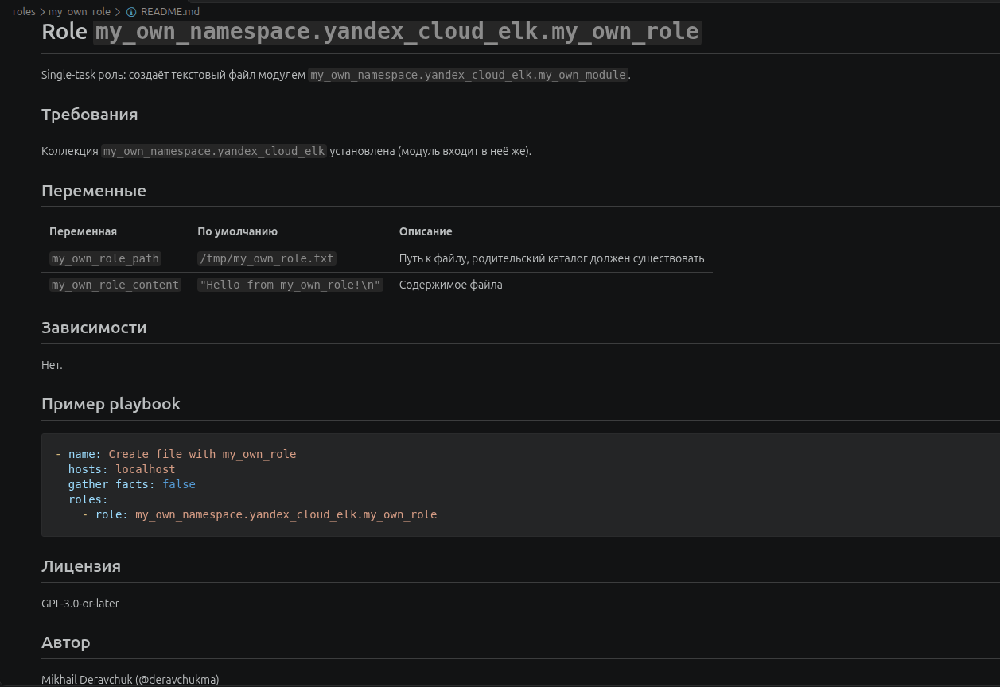

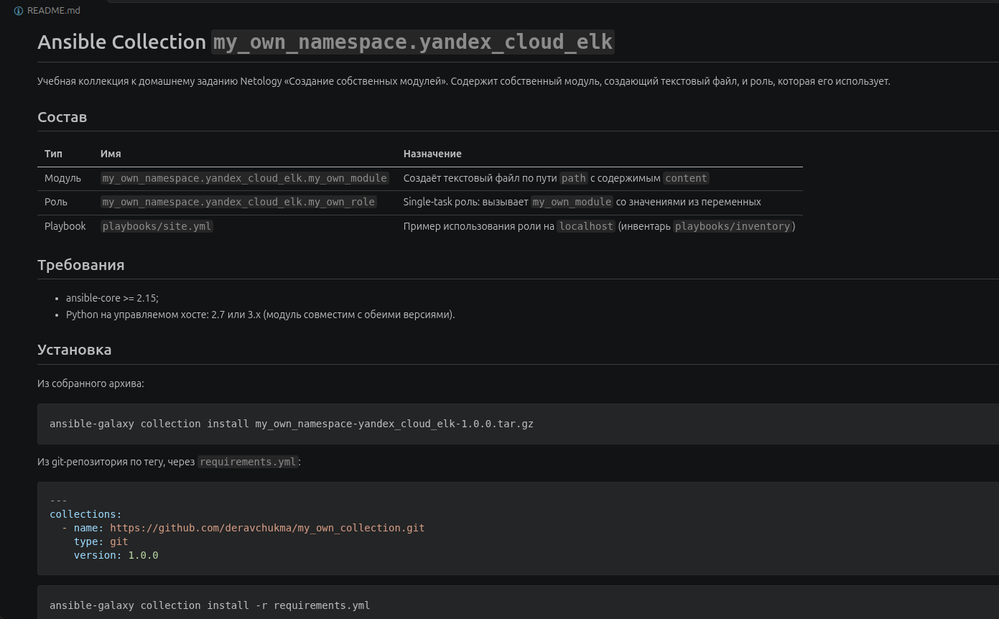

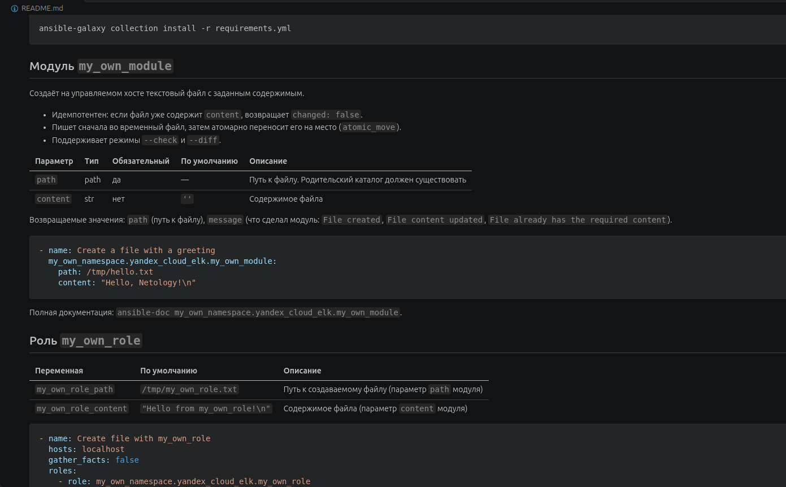

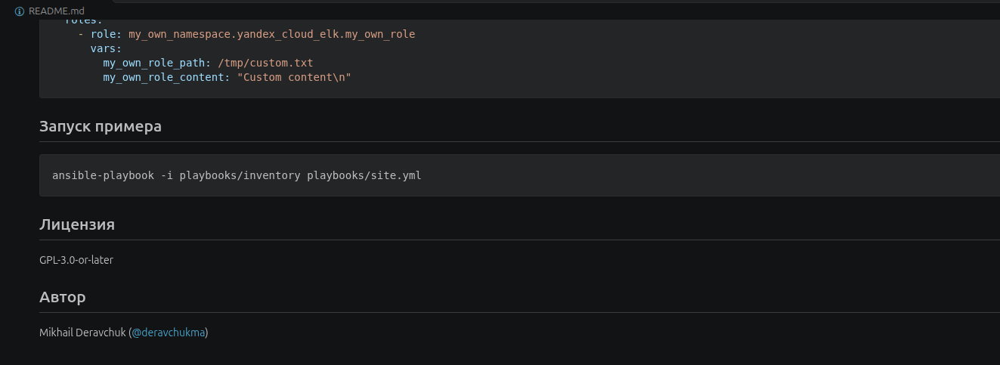

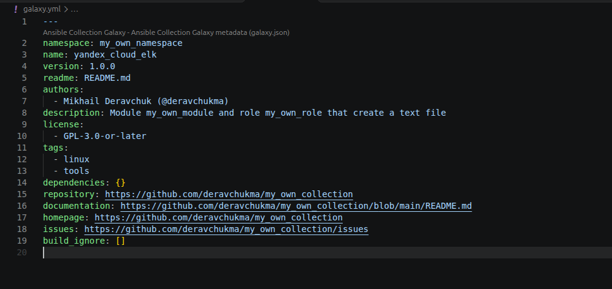

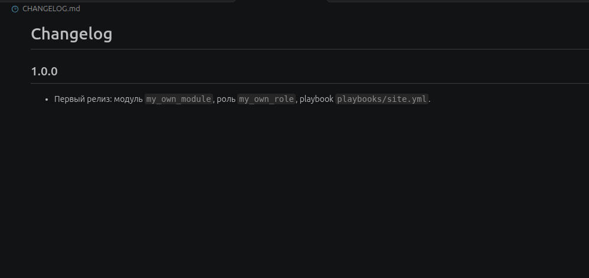

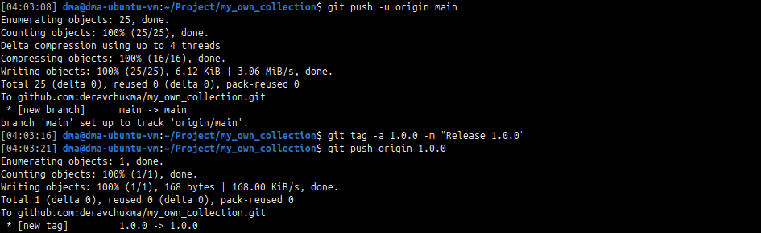

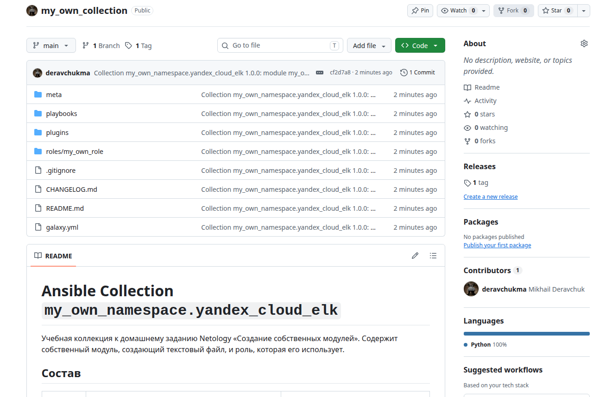


**Шаг 13.** Создайте .tar.gz этой collection: `ansible-galaxy collection build` в корневой директории collection.

**Выполнено**

Перед сборкой удалён служебный каталог `.ansible/`, который создаёт ansible-lint: `ansible-galaxy collection build` не учитывает `.gitignore`.

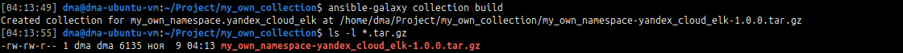


**Шаг 14.** Создайте ещё одну директорию любого наименования, перенесите туда single task playbook и архив c collection.

**Выполнено**

Каталог [install](./install): `site.yml`, `inventory/hosts.yml` и архив коллекции.

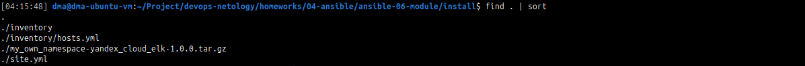


**Шаг 15.** Установите collection из локального архива: `ansible-galaxy collection install <archivename>.tar.gz`.

**Выполнено**

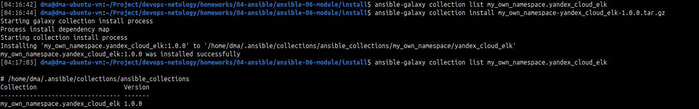


**Шаг 16.** Запустите playbook, убедитесь, что он работает.

**Выполнено**

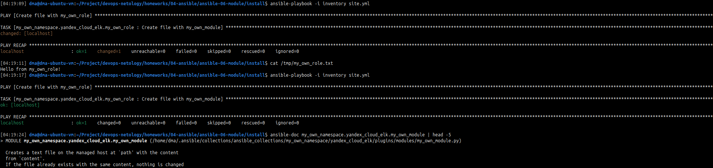


**Шаг 17.** В ответ необходимо прислать ссылки на collection и tar.gz архив, а также скриншоты выполнения пунктов 4, 6, 15 и 16.

**Выполнено**

- Collection: https://github.com/deravchukma/my_own_collection/tree/1.0.0
- Архив tar.gz: [my_own_namespace-yandex_cloud_elk-1.0.0.tar.gz](https://github.com/deravchukma/devops-netology/blob/08-ansible-06-module/homeworks/04-ansible/ansible-06-module/install/my_own_namespace-yandex_cloud_elk-1.0.0.tar.gz)


## Необязательная часть

1. Реализуйте свой модуль для создания хостов в Yandex Cloud.
2. Модуль может и должен иметь зависимость от `yc`, основной функционал: создание ВМ с нужным сайзингом на основе нужной ОС. Дополнительные модули по созданию кластеров ClickHouse, MySQL и прочего реализовывать не надо, достаточно простейшего создания ВМ.
3. Модуль может формировать динамическое inventory, но эта часть не является обязательной, достаточно, чтобы он делал хосты с указанной спецификацией в YAML.
4. Протестируйте модуль на идемпотентность, исполнимость. При успехе добавьте этот модуль в свою коллекцию.
5. Измените playbook так, чтобы он умел создавать инфраструктуру под inventory, а после устанавливал весь ваш стек Observability на нужные хосты и настраивал его.
6. В итоге ваша коллекция обязательно должна содержать: clickhouse-role (если есть своя), lighthouse-role, vector-role, два модуля: my_own_module и модуль управления Yandex Cloud хостами и playbook, который демонстрирует создание Observability стека.

---

### Как оформить решение задания

Выполненное домашнее задание пришлите в виде ссылки на .md-файл в вашем репозитории.

---
